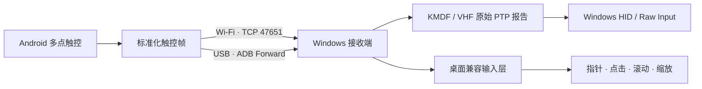

<div align="center">

# MoTouchPad

### 把 Android 手机或平板变成 Windows 触控板

[](android-app/)
[](windows-app/)
[](windows-app/MoTouchPad.Windows.csproj)
[](windows-driver/)
[](#当前限制)

通过 Wi‑Fi 或 USB 连接，将 Android 多点触控数据实时发送到 Windows。  
支持移动、轻触、右击、双指滚动、自然滚动和捏合缩放。

</div>

<table>
  <tr>
    <td width="50%"></td>
    <td width="50%"></td>
  </tr>
  <tr>
    <td align="center">顶部状态岛与 USB / Wi‑Fi 连接识别</td>
    <td align="center">灵敏度、自然滚动与当前 Wi‑Fi 地址</td>
  </tr>
</table>

## 功能

- 横屏沉浸式触控区域，适合手机和平板。
- Wi‑Fi TCP 直连，Android 端实时显示局域网地址。
- USB 调试模式下一键建立 ADB 端口转发。
- 自动显示等待、已连接状态以及 USB / Wi‑Fi 连接方式。
- 50%–200% 指针灵敏度调节，设置持久保存并实时生效。
- 可选自然滚动：双指向下滑动时向上翻页。
- KMDF + Virtual HID Framework 虚拟 Precision Touchpad 驱动。
- 未安装驱动时仍可使用完整的鼠标兼容输入路径。

## 手势

| Android 手势 | Windows 行为 |
|---|---|
| 单指滑动 | 移动指针 |
| 单指轻触 | 左键单击 |
| 双指轻触 | 右键单击 |
| 双指上下滑动 | 垂直滚动 |
| 双指外张 / 捏合 | 放大 / 缩小（`Ctrl + 滚轮`） |

双指手势带有方向锁定和移动阈值，滚动、缩放和双指轻触不会同时触发。

## 工作原理



每个网络包都是一份完整的多点触控快照。协议采用归一化坐标，并在帧头中携带灵敏度和滚动方向设置。详细格式见 [protocol/PROTOCOL.md](protocol/PROTOCOL.md)。

## 快速开始

### 1. 构建并安装 Android 应用

需要 JDK 21、Android SDK 36，以及 Android 8.0（API 26）或更高版本的设备。

```powershell
cd android-app
.\gradlew.bat assembleDebug
adb install -r app\build\outputs\apk\debug\app-debug.apk
```

打开 MoTouchPad 后，设备会自动进入横屏沉浸模式，并监听 TCP 端口 `47651`。

### 2. 构建 Windows 接收端

需要 [.NET 9 SDK](https://dotnet.microsoft.com/download/dotnet/9.0)。若使用 USB 连接，还需确保 Android Platform Tools 中的 `adb` 位于 `PATH`。

```powershell
dotnet build windows-app\MoTouchPad.Windows.csproj -c Debug
dotnet run --project windows-app\MoTouchPad.Windows.csproj
```

连接方式：

1. **USB**：开启 Android 的 USB 调试并授权电脑，然后点击 Windows 端的“USB 连接”。
2. **Wi‑Fi**：确保两台设备处于同一局域网，在 Windows 端输入 Android 设置页显示的 IP 地址并点击“连接”。

不安装驱动也可以使用单击、右击、滚动和缩放等兼容手势。

## 可选：安装虚拟触控板驱动

驱动开发需要 Visual Studio 2022、Windows Driver Kit 10.0.28000.0，以及管理员权限。

```powershell
$msbuild = "C:\Program Files\Microsoft Visual Studio\2022\Community\MSBuild\Current\Bin\MSBuild.exe"
& $msbuild windows-driver\MoTouchPad.Driver.vcxproj `
  /p:Configuration=Debug /p:Platform=x64
```

当前驱动是开发测试签名。启用测试模式会修改系统启动策略，请仅在开发设备或虚拟机中操作：

```powershell
bcdedit /set testsigning on
# 重启 Windows 后，在管理员终端执行：
$pkg = "$PWD\windows-driver\x64\Debug\MoTouchPad.Driver"
devcon install "$pkg\MoTouchPad.Driver.inf" "Root\MoTouchPad"
```

更新已存在的设备节点时使用：

```powershell
devcon update "$pkg\MoTouchPad.Driver.inf" "Root\MoTouchPad"
```

面向普通用户发布前，驱动包必须经过 Microsoft 驱动签名流程。更多环境说明见 [开发指南](docs/development.md)。

## 项目结构

| 路径 | 内容 |
|---|---|
| [`android-app/`](android-app/) | Kotlin Android 触控界面、设置与 TCP 服务端 |
| [`windows-app/`](windows-app/) | .NET 9 WPF 接收端、ADB 连接与兼容手势 |
| [`windows-driver/`](windows-driver/) | KMDF / VHF 虚拟 Precision Touchpad 驱动 |
| [`ios-app/`](ios-app/) | SwiftUI iOS 触控发送端（骨架） |
| [`mac-app/`](mac-app/) | SwiftUI macOS 接收端（骨架） |
| [`mac-driver/`](mac-driver/) | DriverKit 虚拟触控板驱动（骨架） |
| [`protocol/`](protocol/) | 网络帧与驱动 IOCTL 协议 |
| [`tools/ProtocolSmokeTest/`](tools/ProtocolSmokeTest/) | 协议解析冒烟测试 |
| [`docs/`](docs/) | 开发和安装文档 |

## 当前限制

> MoTouchPad 目前是开发原型，不建议直接暴露在不可信网络中。

- TCP 传输尚未加入配对、身份验证和加密，仅应在可信局域网使用。
- USB 连接目前依赖 Android USB 调试和 ADB；生产版可替换为 AOA / WinUSB 传输。
- 部分 Windows 版本不会把软件创建的虚拟 PTP 设备接入桌面手势栈，因此当前同时保留原始 VHF 报告和稳定的桌面兼容输入层。
- 开发驱动需要 Windows 测试签名模式；正式发行需要 Microsoft 签名。

## 路线图

- 安全配对与加密传输。
- 无需 USB 调试的生产级 USB 通道。
- 横向滚动、拖拽和更多可配置手势。
- Windows 与 Android 安装包自动化发布。
- 正式签名的 Windows 驱动包。

## 开发

完整构建环境、驱动签名和安装说明见 [docs/development.md](docs/development.md)。提交修改前建议运行：

```powershell
dotnet build windows-app\MoTouchPad.Windows.csproj -c Debug
dotnet run --project tools\ProtocolSmokeTest\ProtocolSmokeTest.csproj

cd android-app
.\gradlew.bat :app:assembleDebug :app:lintDebug
```

