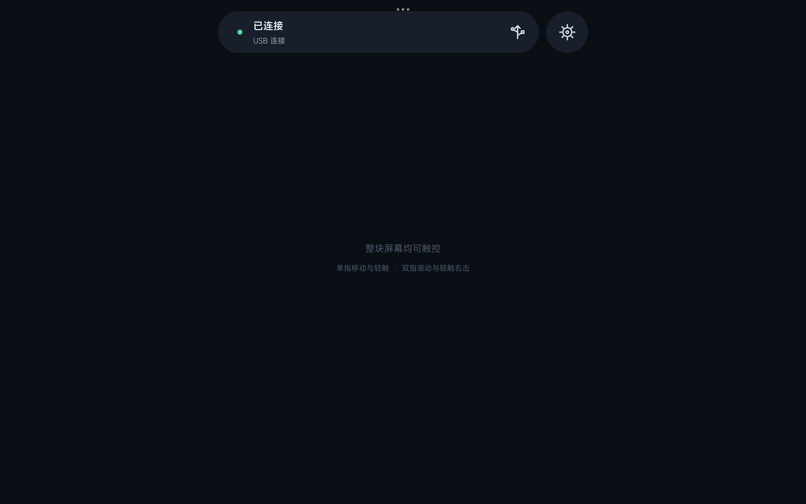
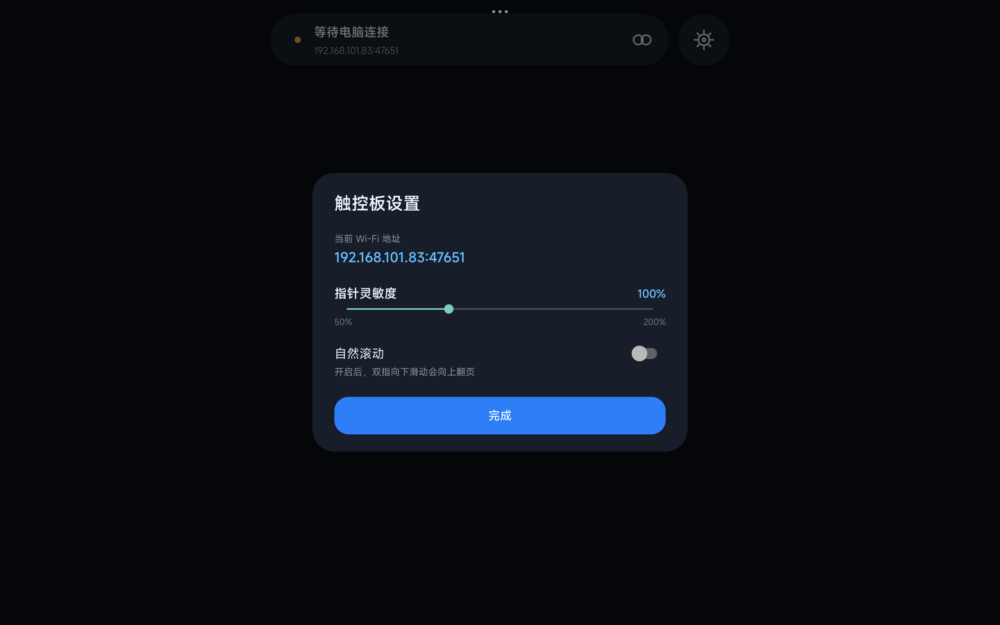

# MoTouchPad

### 把移动设备变成桌面触控板

Android / iOS 负责采集并发送原始多点触控快照，Windows / macOS 负责接收、
手势解释和平台输入注入。协议 v1 固定使用 TCP 47651，桌面端按平台能力
选择输入后端。

<table>
  <tr>
    <td width="50%"></td>
    <td width="50%"></td>
  </tr>
  <tr>
    <td align="center">USB / Wi-Fi 连接状态</td>
    <td align="center">灵敏度、自然滚动与 Wi-Fi 地址</td>
  </tr>
</table>

## 功能

- Android 和 iOS 全屏多指触控采集，发送完整原始快照。
- Wi-Fi TCP 直连；Android 支持 USB 调试下的 ADB 端口转发。
- Windows 默认使用 MouseFallback，支持移动、左键、右键、滚动和缩放。
- macOS 默认使用 CGEvent，并按当前显示器的逻辑坐标注入输入。
- 灵敏度只影响指针移动；自然滚动只影响滚动方向。
- Windows VHF 和 macOS DriverKit 作为独立实验模块保留，不阻塞应用 CI。

## 手势契约

| 移动设备手势 | 桌面行为 |
|---|---|
| 单指移动 | 相对指针移动 |
| 单指轻触 | 左键单击 |
| 双指轻触 | 右键单击 |
| 双指移动 | 滚动 |
| 双指间距变化 | 缩放 |
| 三指及以上 | 静默，直到全部触点抬起 |

移动端不预计算点击、滚动或缩放；UP 联系人只发送一次，桌面端用它完成
点击判定和状态清理。

## 数据流

    Android / iOS UI
      -> TouchFrame Model
      -> protocol v1 codec
      -> TCP 或 ADB Forward
      -> Windows / macOS decoder
      -> TouchFrame Router
      -> Compatibility / CGEvent / Experimental VHF

线格式见 [protocol/PROTOCOL.md](protocol/PROTOCOL.md)，完整责任边界见
[docs/architecture.md](docs/architecture.md)。

## 快速开始

### Android

需要 JDK 21、Android SDK 36，以及 Android 8.0（API 26）或更高版本设备。

    cd android-app
    ./gradlew :app:assembleDebug :app:lintDebug :app:testDebugUnitTest
    adb install -r app/build/outputs/apk/debug/app-debug.apk

### Windows

需要 .NET 9 SDK；USB 连接还需要 Android Platform Tools 中的 adb。

    dotnet build windows-app/MoTouchPad.Windows.csproj -c Debug
    dotnet run --project windows-app/MoTouchPad.Windows.csproj

Windows UI 默认使用鼠标兼容模式。只有显式勾选实验性 VHF 时才提交驱动；
两条输入路径不会同时提交。驱动打开或提交失败会自动回到兼容层，失败帧
不会重放。

### macOS

    cd mac-app
    swift build
    swift test
    swift run

首次注入鼠标需要在系统设置的隐私与安全性 → 辅助功能中授权 MoTouchPad。

### iOS

    xcodebuild -project ios-app/ios-app.xcodeproj -scheme MoTouchPad -destination 'generic/platform=iOS' build CODE_SIGNING_ALLOWED=NO

首次运行需要允许本地网络访问，应用会在本地网络权限说明中提示用途。

## 项目结构

| 路径 | 内容 |
|---|---|
| [android-app/](android-app/) | Android 触控采集、设置、协议与 TCP 服务端 |
| [ios-app/](ios-app/) | iOS 触控采集、设置、协议与 TCP 服务端 |
| [windows-app/](windows-app/) | WPF 接收端、TCP/ADB、协议与输入路由 |
| [mac-app/](mac-app/) | macOS 接收端、协议、手势与 CGEvent |
| [windows-driver/](windows-driver/) | 独立 KMDF / VHF 驱动实验 |
| [mac-driver/](mac-driver/) | 独立 DriverKit 驱动实验占位 |
| [protocol/](protocol/) | 唯一网络协议源和跨端黄金样例 |
| [tools/](tools/) | fixture 校验、C# smoke test 和 iOS codec harness |
| [docs/](docs/) | 架构、开发和安装说明 |

## 验证

    python3 tools/validate_protocol_fixtures.py
    cd mac-app && swift test
    cd ../android-app && ./gradlew :app:testDebugUnitTest
    cd .. && dotnet run --project tools/ProtocolSmokeTest/ProtocolSmokeTest.csproj

GitHub Actions 在 Pull Request 和推送到 main 时构建与测试四端应用。CI 不
上传安装包，不签名、不发布，也不打包驱动。驱动需在对应的 Windows + WDK
或 macOS + DriverKit 环境人工验证。

## 当前限制

TCP 传输目前没有配对、身份验证和加密，只应运行在可信局域网。USB 仍依赖
Android USB 调试和 ADB；生产版可替换为正式 USB 通道。Windows 驱动仍需要
测试签名或 Microsoft 签名流程，macOS DriverKit 仍是实验占位。

更多环境说明见 [docs/development.md](docs/development.md)。
